# Barudak Bogor

> Hujanna Asli, Petualanganna Teu Aya Tungtungna. — *The rain is real, the adventure never ends.*

**Dibuat oleh Ariana Mischa Fadhila dari Syubadubin Studios.**
*Made by Ariana Mischa Fadhila of Syubadubin Studios.*

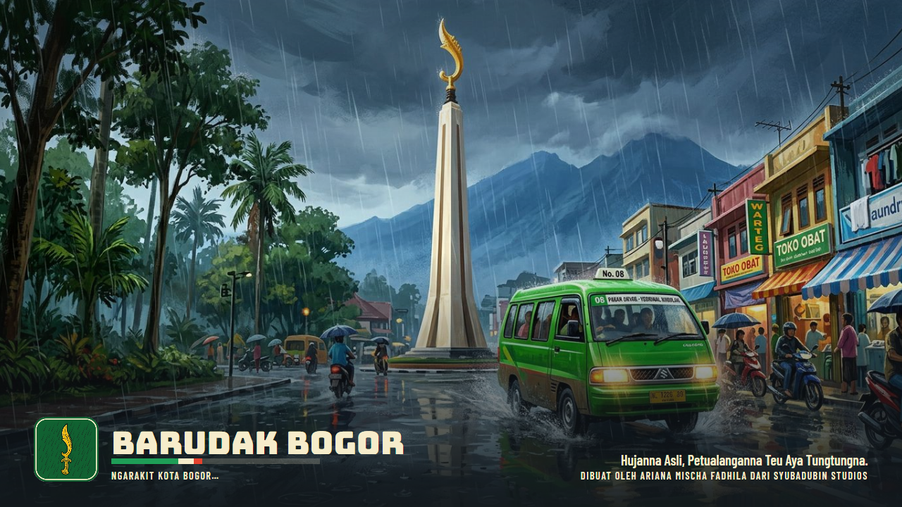

Game open-world bergaya GTA berlatar Kota Bogor dan sekitarnya: hujan yang benar-benar turun, angkot hijau, cilok, bandrek, dan humor Sunda. Dibangun dengan **.NET 10**, mesin grafis **Three.Net** (inti **Rust**/wgpu) dan **Avalonia UI**.

An open-world, GTA-style game set in and around the city of Bogor: rain that really falls, green angkot minibuses, street food and Sundanese humour. Built with **.NET 10**, the **Three.Net** graphics engine (a **Rust**/wgpu core) and **Avalonia UI**.

| | |
|---|---|
| 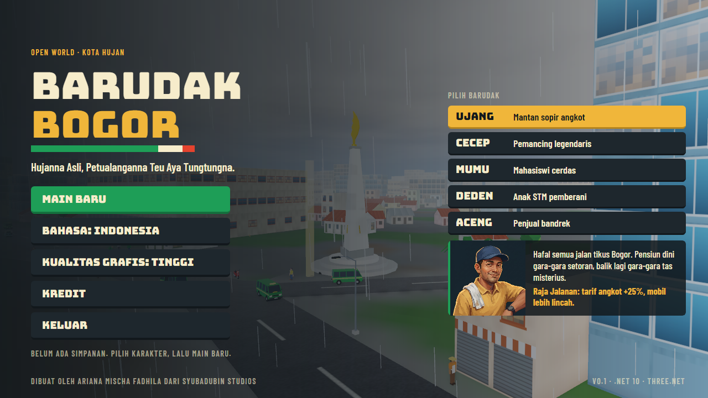 | 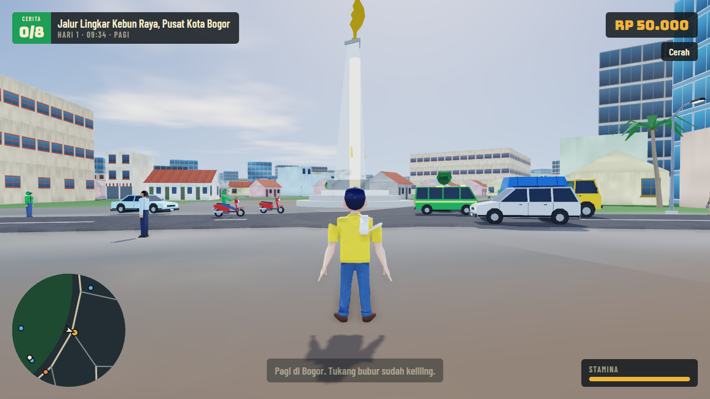 |
| Menu utama dan pilihan karakter / Title and character select | Tugu Kujang, titik awal cerita / where the story starts |
| 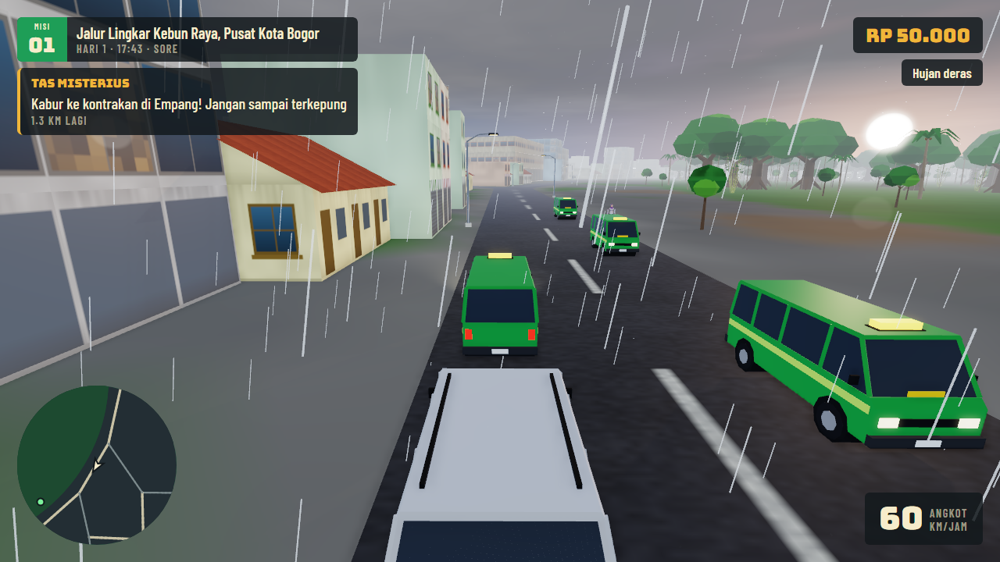 | 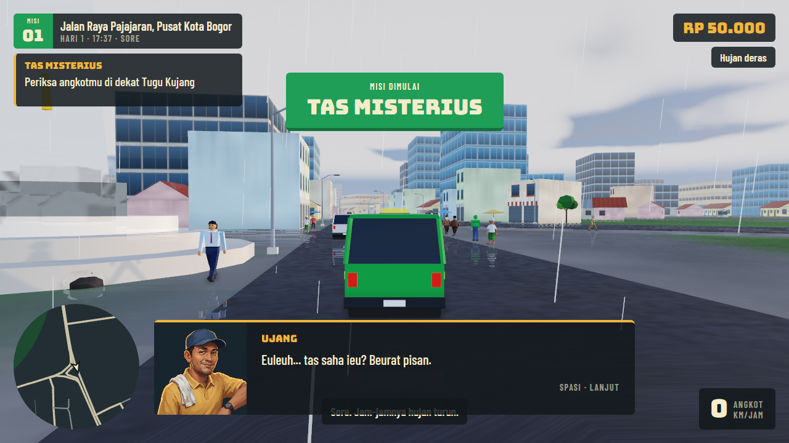 |
| Misi "Tas Misterius" saat hujan deras / The prologue chase in heavy rain | Dialog dengan potret karakter / Dialogue with character portraits |
| 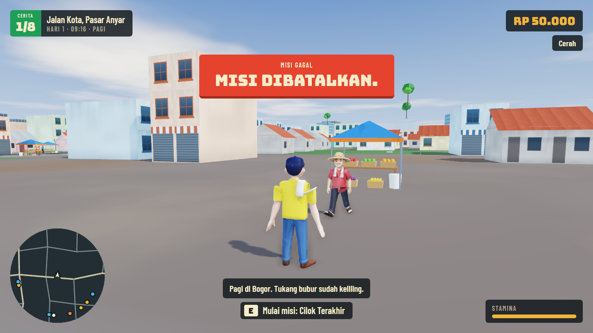 | 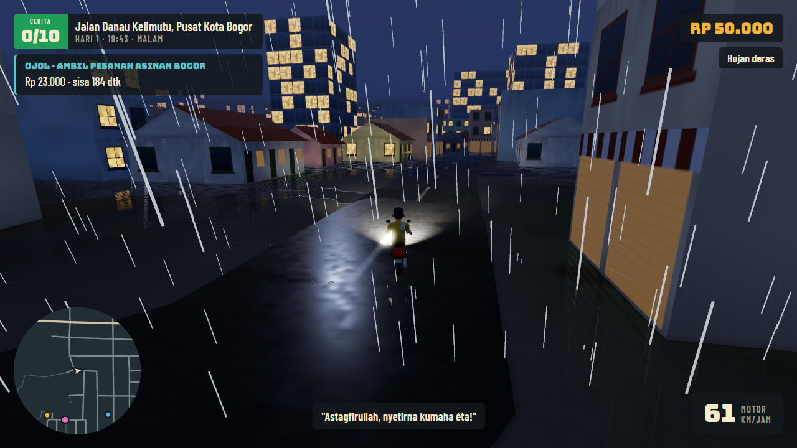 |
| Mang Udin menunggu di Pasar Anyar / A mission giver at Pasar Anyar | Ojol di malam hujan / Ojol duty on a rainy night |
| 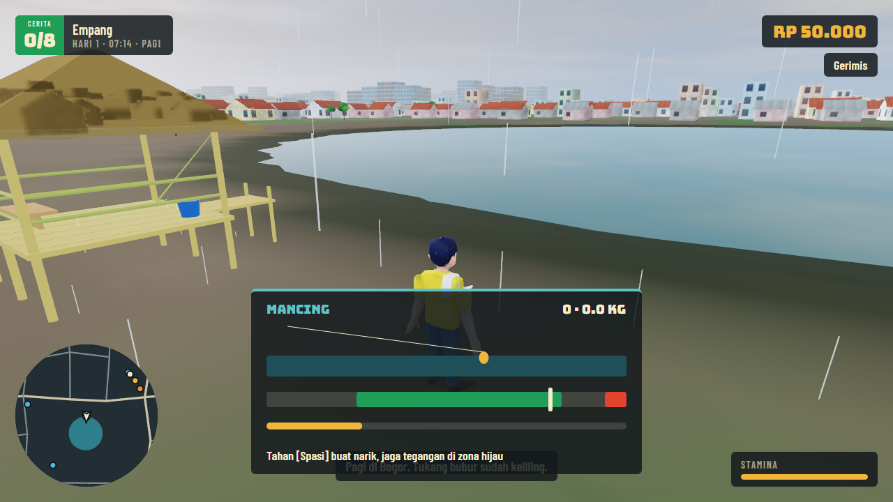 | 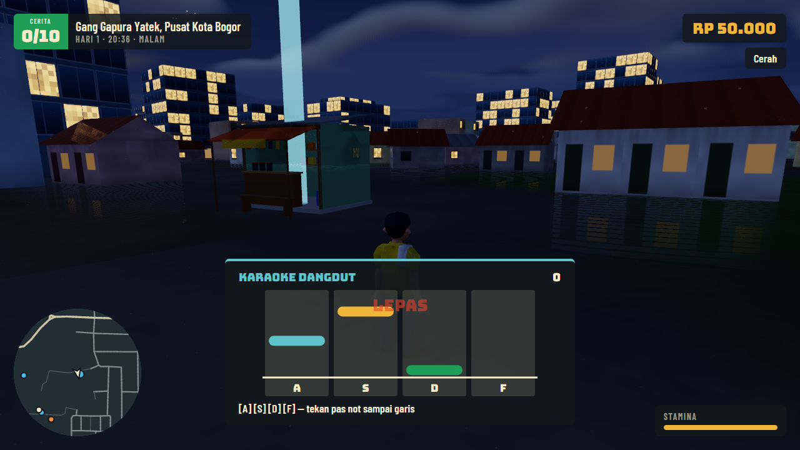 |
| Mancing di empang / Fishing at the pond | Karaoke dangdut / Dangdut karaoke |
| 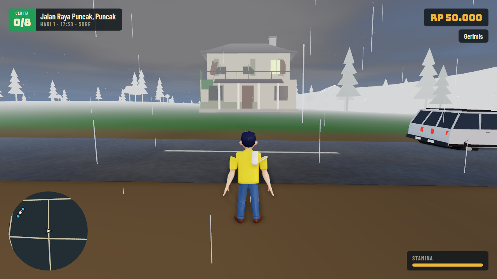 | 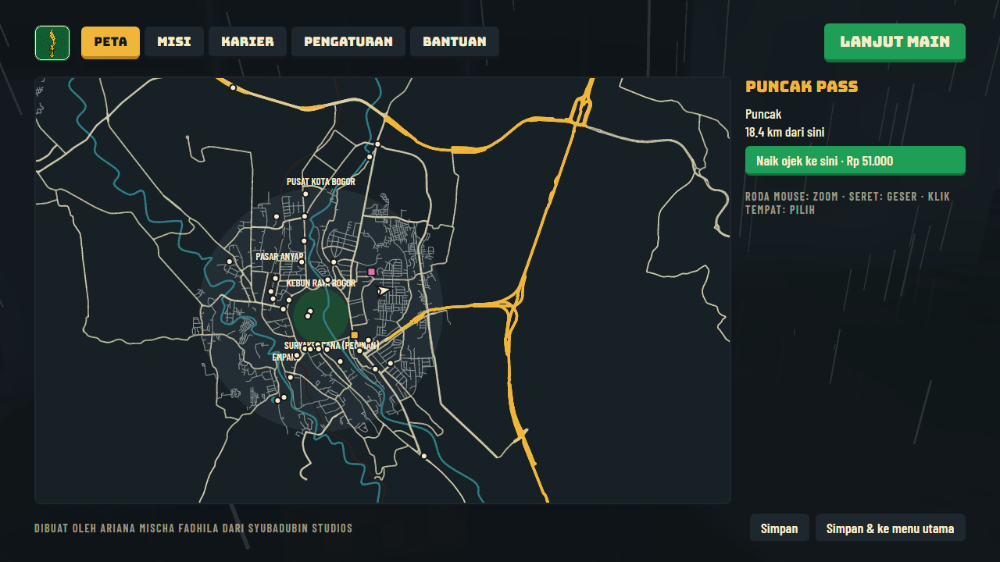 |
| Villa Misterius di kabut Puncak / The Mysterious Villa in Puncak fog | Peta 40 km x 40 km dan ojek cepat / The map and fast travel |
| 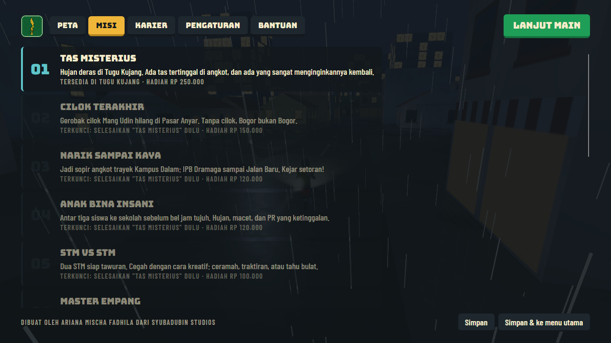 | 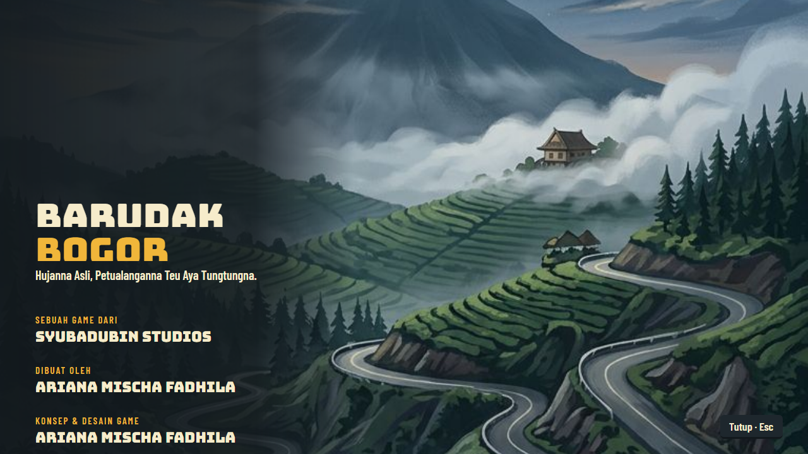 |
| Daftar misi / Mission list | Kredit bergulir / Scrolling credits |

| 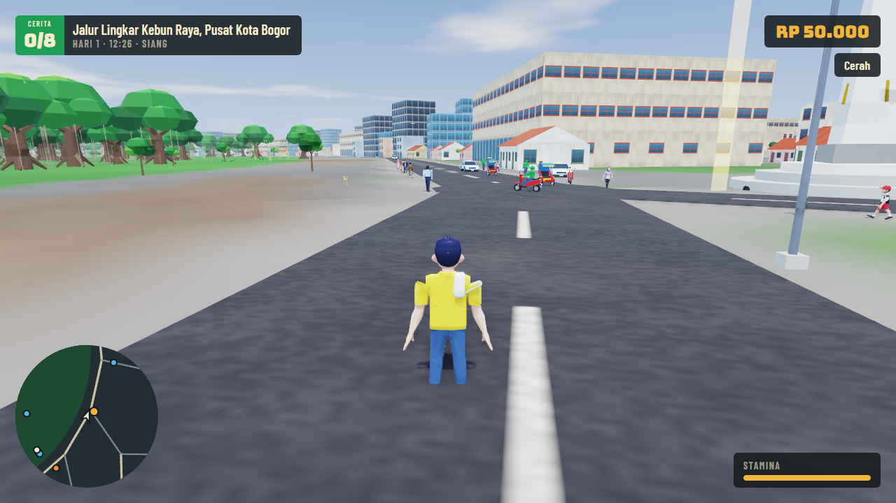 | 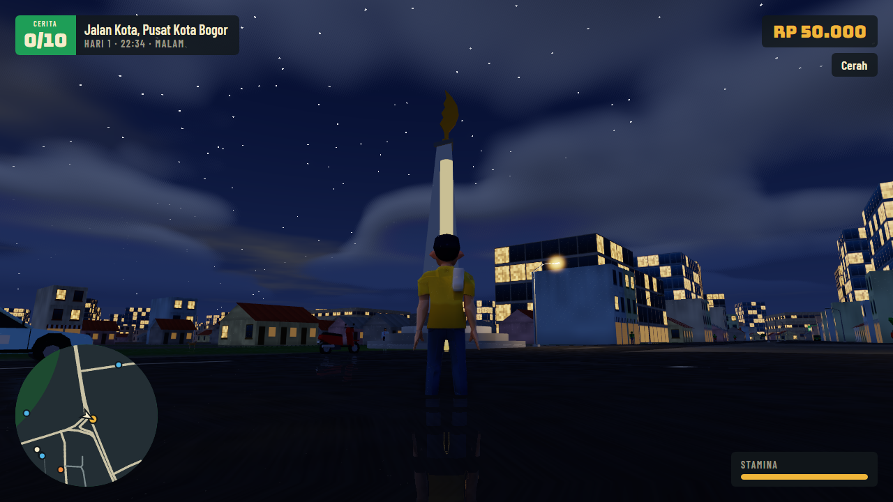 |
|---|---|
| Lalu lintas dan warga di jalur lingkar / Traffic and townsfolk on the ring road | Bintang dan awan malam / Stars and night cloud |
| 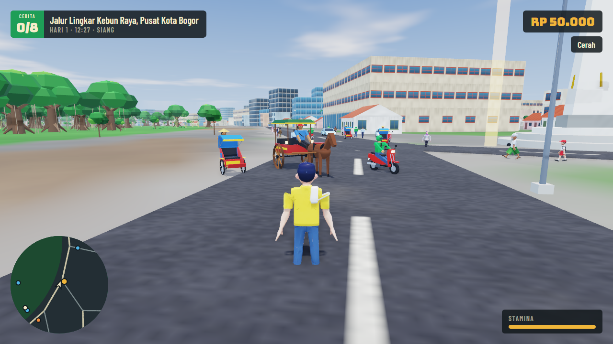 | 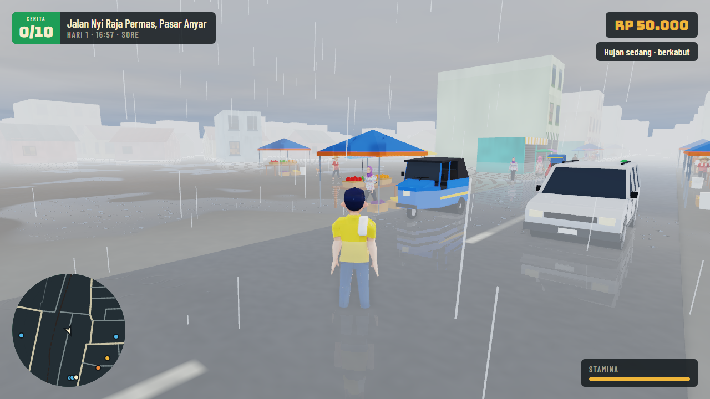 |
| Becak, delman, dan ojek dengan pengendaranya / Becak, delman and ojek with their riders | Hujan yang membawa kabut / Rain that brings mist |

Semua gambar di atas diambil dari game yang berjalan (`--capture`). / Every picture above was captured from the running game (`--capture`).

---

## Bahasa Indonesia

### Status

Ini **fondasi yang bisa dimainkan** (v0.1), bukan game AAA yang sudah jadi. Yang sudah ada:

- Dunia 40 km x 40 km yang di-streaming: 8 area (Pusat Kota, Kebun Raya, Pasar Anyar, Dramaga, Sentul, Empang, Puncak, Gang Selot), sekitar 1.240 ruas jalan dan 32.000 bangunan prosedural.
- Cuaca dinamis: cerah, berawan, gerimis, hujan sedang, hujan deras, badai petir, kabut Puncak, mati lampu lokal. Jalan basah membuat ban lebih licin.
- 13 kendaraan (angkot, motor, mobil keluarga, taksi, truk, delman, becak, bemo, bajaj, mobil tahu bulat, mobil bakso, gerobak cilok, gerobak bandrek), lalu lintas dan warga yang ramai, 9 jenis hewan termasuk kucing, anjing, dan ayam kampung.
- Siang-malam 24 menit dengan pagi, siang, sore, malam; langit berawan, berbintang, berbulan; kabut yang kadang datang bersama hujan.
- Musik latar laras degung yang digubah oleh kode.
- 5 karakter dengan kemampuan berbeda dan 8 misi cerita.
- Aktivitas: mancing, ojol, touring Puncak, badminton kampung, karaoke, fotografi hujan, usaha bandrek.
- 5 karier/akhir cerita, simpan otomatis, dua bahasa (Indonesia/Inggris).

Yang belum: lihat [PLAN.md](PLAN.md) dan [Progress.md](Progress.md). Visualnya low-poly bergaya, belum setara AAA, dan performa di grafis terintegrasi terbatas (sekitar 30 fps di Intel UHD 620 pada kualitas Hemat atau Sedang, 18 fps pada Tinggi).

### Menjalankan

Kebutuhan: Windows 10/11 64-bit, .NET SDK 10, GPU dengan DirectX 12.

```bash
dotnet run --project src/BarudakBogor.Game -c Release
```

### Installer

Unduh dari halaman [Releases](https://github.com/SyubadubinStudios/Barudak.Bogor/releases): installer Windows (`.exe`) atau zip portabel, `.deb` atau `.tar.gz` untuk Linux, dan `.dmg` untuk macOS (Apple Silicon dan Intel). .NET tidak perlu dipasang. Hanya build Windows yang sudah dijalankan dan diuji; Linux dan macOS dibuat oleh CI dan belum dicoba di perangkat sungguhan. Aplikasi macOS belum dinotarisasi: klik kanan lalu Open saat pertama kali.

### Kontrol

| Tombol | Fungsi |
|---|---|
| W A S D | Jalan / nyetir |
| Mouse (seret) | Putar kamera |
| Shift | Lari |
| Spasi | Lompat, rem tangan, aksi mini game |
| E | Naik/turun kendaraan, bicara, mulai misi |
| H | Klakson |
| O | Aplikasi ojol nyala/mati (di atas motor) |
| P | Potret |
| M / Esc | Peta dan menu |
| F5 | Simpan cepat |

### Dokumentasi

- [Memulai](docs/id/memulai.md) · [Panduan bermain](docs/id/panduan-bermain.md) · [Arsitektur](docs/id/arsitektur.md)
- [PLAN.md](PLAN.md) — roadmap · [Progress.md](Progress.md) — catatan pengembangan

---

## English

### Status

This is a **playable foundation** (v0.1), not a finished AAA game. What exists:

- A streamed 40 km x 40 km world: 8 areas (City Centre, Botanical Gardens, Pasar Anyar, Dramaga, Sentul, Empang, Puncak, Selot Alley), about 1,240 road segments and 32,000 procedural buildings.
- Dynamic weather: clear, cloudy, drizzle, rain, heavy rain, thunderstorm, Puncak fog and local blackouts. Wet roads reduce tyre grip.
- 13 vehicles (angkot, motorbike, family car, taxi, truck, horse cart, becak, bemo, auto rickshaw, tahu bulat truck, bakso truck, cilok cart, bandrek cart), busy traffic and townsfolk, and 9 kinds of animals including stray cats, dogs and chickens.
- A 24-minute day with morning, midday, afternoon and night; a sky with clouds, stars and a moon; mist that sometimes comes with the rain.
- Background music in the Sundanese degung scale, composed in code.
- 5 characters with different perks and 8 story missions.
- Activities: fishing, ojol (ride-hailing), Puncak touring, kampung badminton, karaoke, rain photography, a bandrek business.
- 5 careers/endings, autosave, two languages (Indonesian/English).

What is missing: see [PLAN.md](PLAN.md) and [Progress.md](Progress.md). The look is stylised low-poly rather than AAA, and performance on integrated graphics is limited (about 30 fps on Intel UHD 620 at the Hemat or Sedang quality levels, 18 fps at Tinggi).

### Run

Requirements: 64-bit Windows 10/11, .NET SDK 10, a DirectX 12 GPU.

```bash
dotnet run --project src/BarudakBogor.Game -c Release
```

### Installers

Download from the [Releases](https://github.com/SyubadubinStudios/Barudak.Bogor/releases) page: a Windows installer (`.exe`) or portable zip, a `.deb` or `.tar.gz` for Linux, and a `.dmg` for macOS (Apple Silicon and Intel). .NET does not need to be installed. Only the Windows build has been run and tested; the Linux and macOS packages are produced by CI and have not been tried on real machines. The macOS app is not notarised: right-click it and choose Open the first time.

### Controls

| Key | Action |
|---|---|
| W A S D | Walk / drive |
| Mouse (drag) | Look around |
| Shift | Run |
| Space | Jump, handbrake, mini game action |
| E | Enter/leave vehicle, talk, start mission |
| H | Horn |
| O | Ojol app on/off (on a motorbike) |
| P | Take a photo |
| M / Esc | Map and menu |
| F5 | Quick save |

### Documentation

- [Getting started](docs/en/getting-started.md) · [Gameplay guide](docs/en/gameplay.md) · [Architecture](docs/en/architecture.md)
- [PLAN.md](PLAN.md) — roadmap · [Progress.md](Progress.md) — development log

---

## Aset / Assets

| | |
|---|---|
| 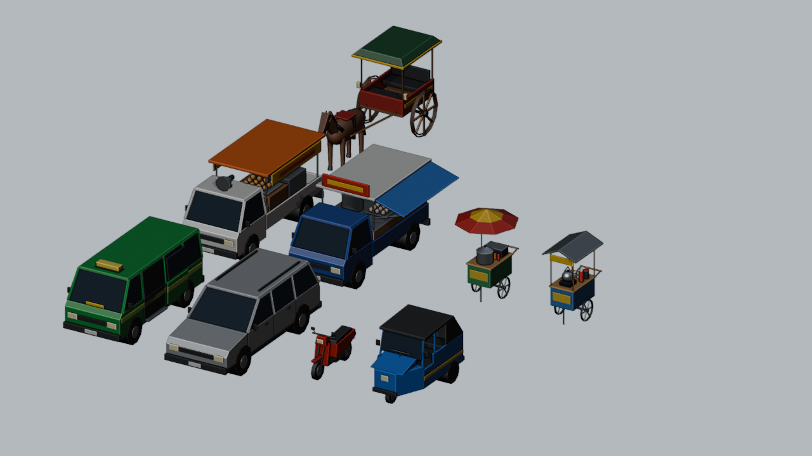 | 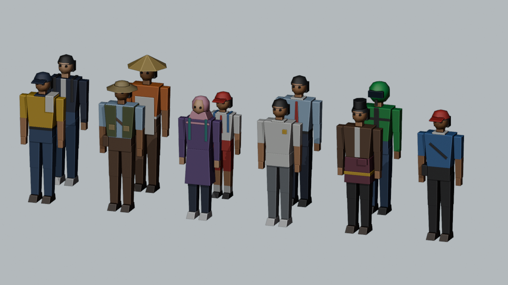 |

- Model low-poly dibuat dengan skrip Blender (`assets/blender/build_all.py`). / Low-poly models are built by Blender scripts.
- Lima karakter utama, warga, dan NPC pemberi misi dibuat dengan Rodin lalu dipotong jadi bagian tubuh oleh `assets/blender/rig_rodin.py`. / The five main characters, townsfolk and mission givers were generated with Rodin and cut into animated parts by `assets/blender/rig_rodin.py`.
- Key art, potret, latar kredit, ikon dan baliho dibuat dengan Rodin MCP (Hyper3D dan Nano Banana 2), lalu diringankan dengan `assets/blender/optimize_rodin.py`. / Mission givers, key art, portraits, credits art, icon and billboard were generated with Rodin MCP and optimised with `assets/blender/optimize_rodin.py`.
- Huruf: Bungee dan Barlow Condensed (SIL Open Font License).

Dibuat oleh Ariana Mischa Fadhila dari Syubadubin Studios.
