# Gameplay guide

Made by Ariana Mischa Fadhila of Syubadubin Studios. · [Bahasa Indonesia](../id/panduan-bermain.md)

## Characters

Each character changes how one part of the game plays.

| Character | Who | Perk |
|---|---|---|
| Ujang | Former angkot driver | +25% angkot fares, better grip in the wet |
| Cecep | Legendary angler | Fish bite sooner, reeling is stronger |
| Mumu | Brilliant student | +15% mission rewards; can talk down the STM brawl |
| Deden | Vocational-school kid | Runs faster, stamina lasts longer; can talk down the STM brawl |
| Aceng | Bandrek seller | +30% profit on sales |

## The world

The map is 40 km x 40 km with Tugu Kujang at its centre. East is right, south is down.

| Area | What is there |
|---|---|
| City Centre | Tugu Kujang, the ring road around the Botanical Gardens, offices and shophouses |
| Botanical Gardens | Big trees, squirrels, the Palace deer lawn |
| Pasar Anyar | Market tents, kiosks, crowds: the best place to sell bandrek |
| Selot Alley | A maze of alleys only motorbikes and carts fit through |
| Empang | Kampung houses, the fishing pond, the badminton court, your rented room |
| Dramaga | The IPB campus, the angkot terminal and Situ Gede lake to its north-east, all where they really are, north-west of the city |
| Sentul | The Sentul circuit and its housing estates in the north, reached by the Jagorawi toll road |
| Puncak | Puncak Road from Ciawi up to Cisarua: tea fields, pine forest, fog, monkeys and the Mysterious Villa |

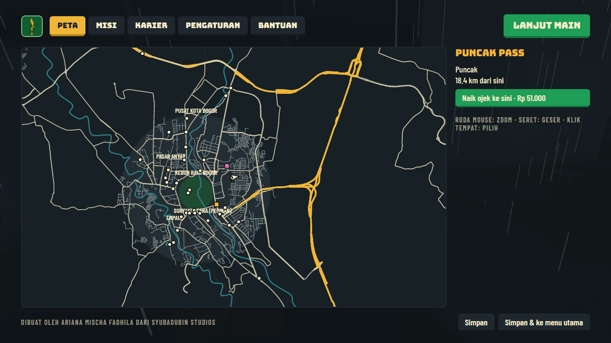

Driving from the city to Puncak takes about a quarter of an hour. The map (**M**) lets you take an ojek to any named place for a fare; that is not possible during a mission.

## Weather and time

A game day lasts 24 real minutes. Rain is most likely between 13:00 and 19:30.

- **Wet roads** halve tyre grip: brake early and steer gently.
- **Thunderstorms** can cut the power in a neighbourhood for a minute or two: windows and street lamps go dark.
- **Puncak fog** is thickest at dawn, dusk and in rain.
- Rain helps: fish bite sooner, ojol orders pay 50% more, bandrek sells faster, and photos score higher.

## Story missions

Start a mission at its gold beacon, where the mission giver waits. "Tas Misterius" unlocks the rest.

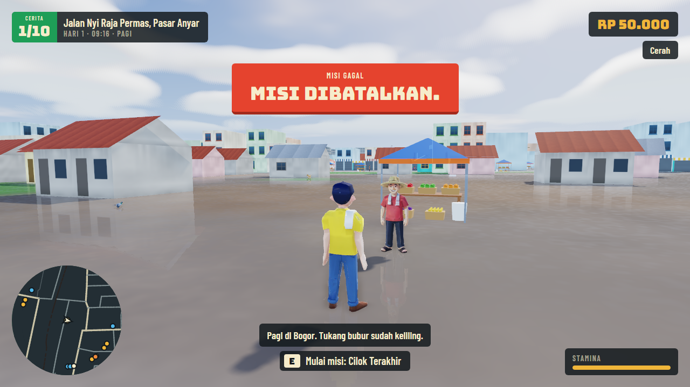

| # | Mission | Where | What you do |
|---|---|---|---|
| 1 | Tas Misterius | Tugu Kujang | Find the bag in your angkot, then outrun two black cars to Empang |
| 2 | Cilok Terakhir | Pasar Anyar | Follow three clues, find the cart in Selot Alley, push it back |
| 3 | Narik Sampai Kaya | Dramaga terminal | Drive the angkot route to Jalan Baru, stopping at every halte |
| 4 | Anak Bina Insani | Empang | Pick up the kids and reach school before 07:00 |
| 5 | STM vs STM | Field by the school | Stop the brawl: a speech, a round of bandrek, or the tahu bulat truck |
| 6 | Master Empang | Empang | Land 4 kg of fish in three minutes |
| 7 | Bandrek King | Aceng's stall | Push the cart somewhere busy and sell eight cups |
| 8 | Horor Puncak | Puncak Pass | Investigate the villa at night, on foot |

A failed or abandoned mission can be started again. The game cannot be saved while a mission is running.

## Activities

| Activity | Where | How |
|---|---|---|
| Fishing | Empang, Situ Gede | Space to cast, Space when the float dips, then hold Space to reel while keeping the needle in the green band |
| Ojol | Anywhere, on a motorbike | **O** goes on duty; ride to the pick-up, then to the drop-off before the timer ends |
| Puncak touring | Ciawi junction | In a motor vehicle, pass every checkpoint up to Puncak Pass; the prize depends on your time |
| Kampung badminton | Empang | A/D as the shuttle reaches the line; three misses lose the set |
| Karaoke | City Centre | A/S/D/F as each note reaches the line |
| Photography | Anywhere | **P**. Rain, lightning, fog, golden hour, landmarks and animals in frame add points; 40 points or more gets paid. Pictures are saved to `Pictures\BarudakBogor` |
| Bandrek business | Aceng's stall | Buy stock, push the cart, stop where people are. Upgrade to a stall, a café, a franchise; collect the takings at the stall |

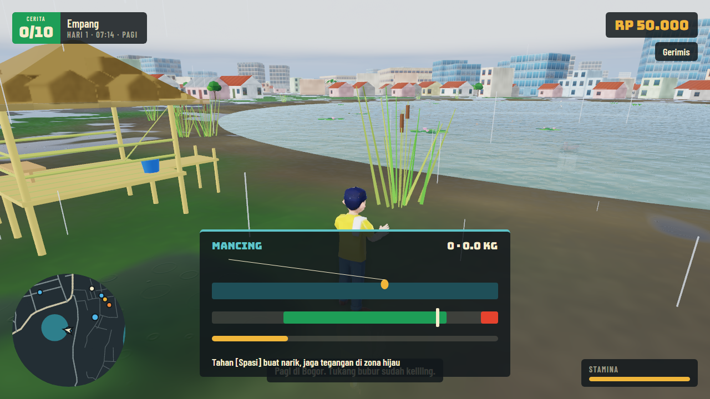

## Careers

Reach 100 reputation in a career to earn its title. The game continues afterwards.

| Title | How to earn reputation |
|---|---|
| Raja Angkot | The angkot route mission |
| Pengusaha Bandrek | Selling cups and upgrading the business |
| Influencer Kuliner | Paid photos, food deliveries, karaoke |
| Pemancing Legendaris | Catching fish, winning the tournament |
| Walikota | Story missions, passenger orders, touring, badminton. Finishing all ten story missions grants it outright |

Driving at pedestrians costs Walikota reputation. They always jump clear.

## The city

The whole map is laid out like the real Bogor, measured from Tugu Kujang (map data © OpenStreetMap contributors): the loop round the Botanical Gardens (Pajajaran, Otista, Juanda, Jalak Harupat), every main road out to the edge of the map, the Jagorawi, Bogor Outer Ring and Bocimi toll roads, the Ciliwung and the Cisadane, the commuter railway, and the line to Sukabumi that leaves from Bogor Paledang. The side streets and alleys of the city centre, Dramaga, Sentul and Cisarua are the real ones too. Outside those four areas only the main roads are there.

What is not exact: the real Puncak Pass and Telaga Warna lie about 2 km beyond the eastern edge of the map, so the game puts them at Cisarua. Toll interchanges are drawn on the level, without flyovers.

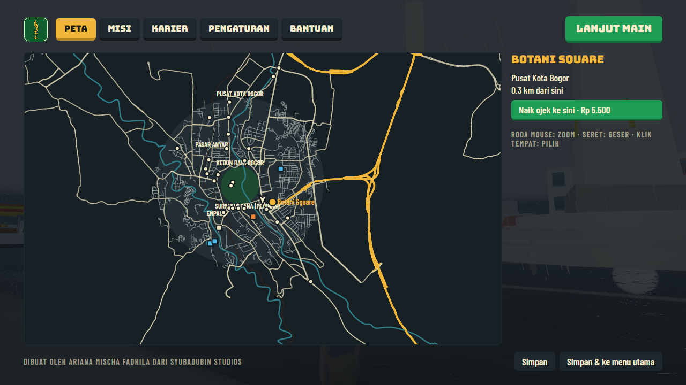

Places you can find and fast-travel to include Bogor Palace, the museums (Zoology, PETA, Soil and Agriculture), the malls (Botani Square, Bogor Trade Mall, Yogya Bogor Junction, Ramayana, Plaza Jambu Dua, Ekalokasari, Lotte Mart, Bogor Great Mall), the Suryakencana gate, the Fountain, Sempur Field, Pajajaran Sports Ground, Bogor Station and Baranangsiang Terminal. All of them carry a name board. Bogor Palace, the three museums, City Hall, the Cathedral, the Grand Mosque and the Suryakencana gate have buildings of their own; the malls are still plain blocks.

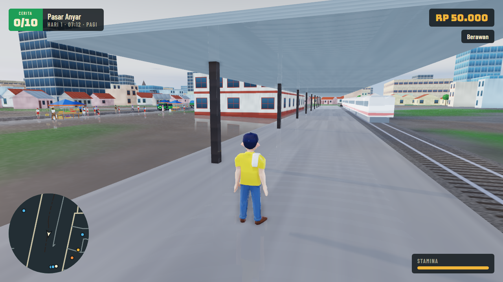

The commuter train leaves Bogor Station every few minutes and comes back. It stops for anyone on the track, and traffic waits at the level crossings.

## Street life

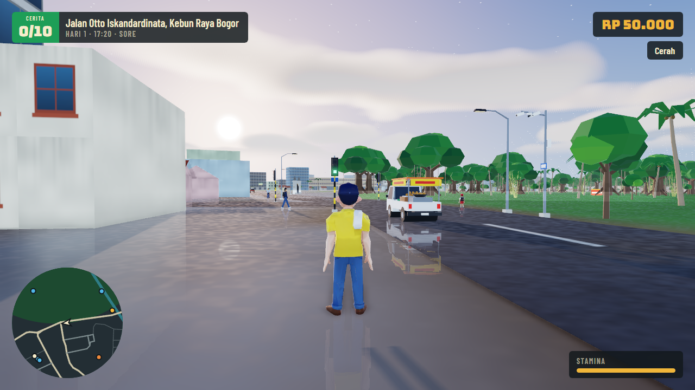

Other vehicles do not pass through one another: they queue, go round an angkot that has stopped for passengers when the oncoming lane is clear, take turns at junctions and stop at red lights. The lights stand where main roads meet in town, and each arm gets its turn at green. They bind the traffic only: you are free to go, and nobody writes tickets.

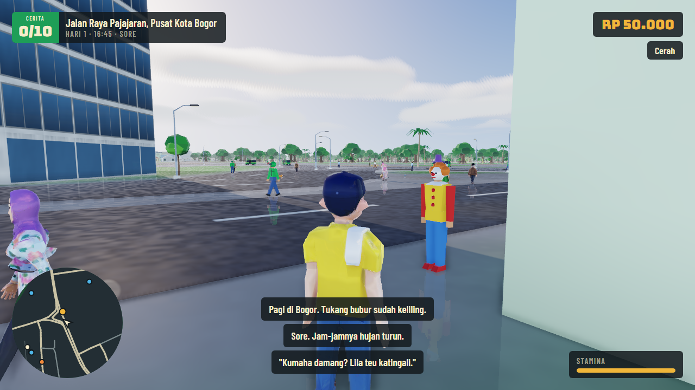

Among the townsfolk are hawkers with carrying poles, police officers, civil servants in khaki (mornings and late afternoons), clowns (daytime), buskers and punks (afternoon into the night). Police, clowns, buskers and punks stand about more than they walk.

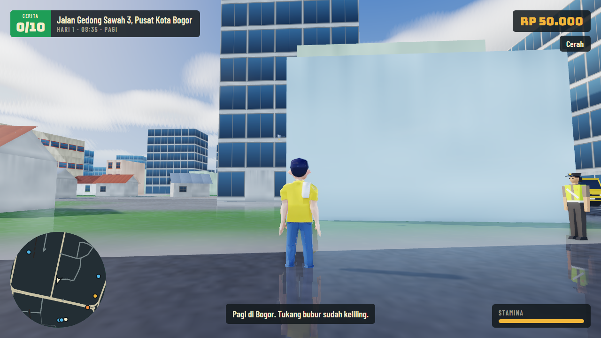

Flocks of pigeons peck about at Tugu Kujang, Alun-Alun, Pasar Anyar, the Grand Mosque, the station, City Hall, Sempur and the Gardens gate. Walk up to them (or drive past) and they fly off and come down somewhere else. Monkeys now also live in the Gardens near the gate, and chickens roam around Ujang's lodging, Empang and Gang Selot.

Along the streets of the centre there are banners, shop light boxes that glow at night, CCTV masts and LED screens whose advert changes every six seconds.

## Life in the water

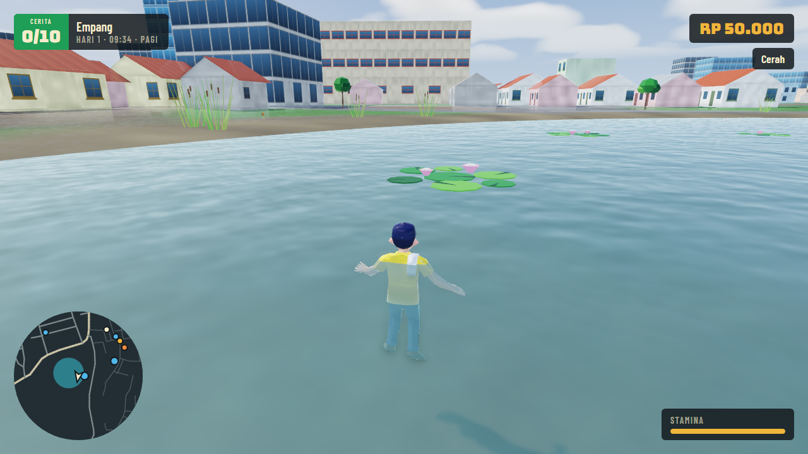

The three ponds (Empang, Situ Gede, Telaga Warna) and both rivers are lived in. Every pond has carp swimming just under the surface, turtles with their shells showing, and ducks. Along the Ciliwung and the Cisadane there is a shoal of fish about every 400 m, and in turn turtles, ducks or a single crocodile.

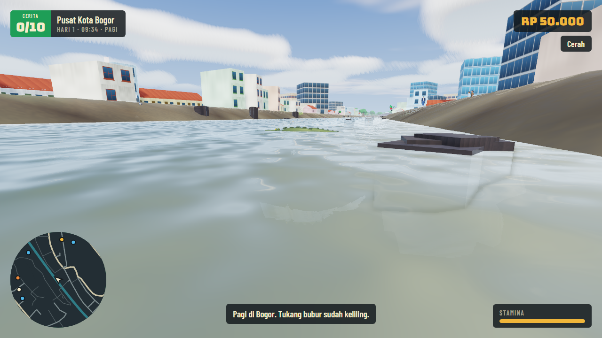

The crocodile is lazy and harmless: it drifts, and swims away when you come close. Fish dart off when you get into the water; turtles and ducks keep their distance too. No water animal ever comes ashore.

Lily pads and water hyacinth float near the banks, and reeds grow in the shallows. They are scenery only: you can swim through them and they do not get in the way of fishing.

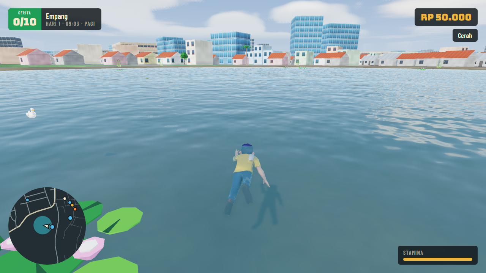

In the water your character swims while moving and treads water when still. The jump (Space) now has a movement of its own, and so have fishing, badminton and karaoke.

## More missions

| | Mission | Starts at | What you do |
|---|---|---|---|
| 9 | What's on the Flash Drive | IPB Dramaga Campus | Open the drive (after The Last Cilok), find the survey stakes at the Gardens gate, get the evidence home |
| 10 | The Town Meeting | Tugu Kujang | Fetch Mang Udin, Haji Dadang and Abah Aceng, then face Mr Beton. Three ways to settle it |
| Side | Lost Parcels | Selot Alley | Three deliveries by motorbike against the clock |
| Side | The Runaway Deer | Palace Deer Lawn | Coax the deer home on foot, without running |
| Side | A Very Special Horse Cart | Botanical Gardens Gate | A slow carriage round; go too fast and the ice cream falls |

## Controller and camera

A controller works in play and in the menus (d-pad moves the highlight, A presses, B goes back, LB/RB change tab). **V** or d-pad right switches between the chase camera and first person. In closed vehicles the first-person lens sits at the nose, because the models have no interiors yet.
