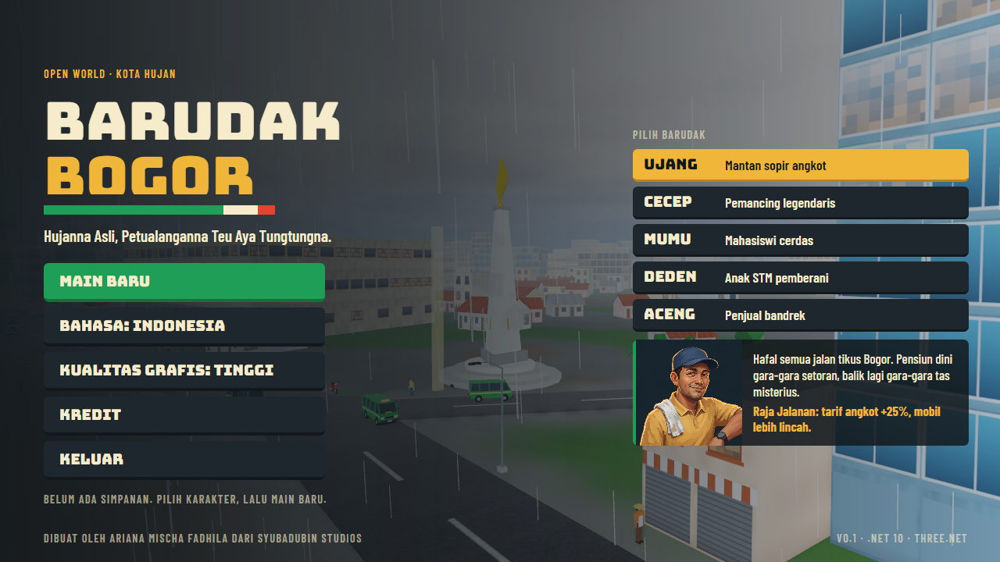

# Getting started

Made by Ariana Mischa Fadhila of Syubadubin Studios. · [Bahasa Indonesia](../id/memulai.md)


## Requirements

- 64-bit Windows 10 or 11 (the only platform tested so far)
- .NET SDK 10
- A GPU with DirectX 12. Integrated graphics work, slowly: about 20–28 fps on Intel UHD 620.

Rust is **not** needed to build the game: the Three.Net native core comes prebuilt in the `ThreeNet.Native` NuGet package.

## Build, run, test

```bash
dotnet build BarudakBogor.slnx -c Release
dotnet run --project src/BarudakBogor.Game -c Release
dotnet test tests/BarudakBogor.Core.Tests
dotnet test tests/BarudakBogor.Core.Tests --filter "FullyQualifiedName~PrologueCanBePlayedThrough"
```

## Command line

| Option | What it does |
|---|---|
| `--capture <folder>` | Plays a scripted tour, saves a screenshot at each stop, then exits. The pictures in the docs come from this. |
| `--bench <file>` | Drives the same stretch at each quality level and writes the frame rates to a text file. |

## First minutes

1. Pick a character on the title screen and choose **Main baru** (New game).
2. Walk to the gold beacon next to Tugu Kujang and press **E** to start "Tas Misterius".
3. Press **M** for the map. Click any place and take an ojek there for a fare.
4. Press **Esc** for missions, careers, settings and the control list.



## Settings

- **Language**: Indonesian or English, switchable at any time.
- **Graphics quality**: Hemat (economy), Sedang (balanced), Tinggi (high). Hemat renders at lower resolution without shadows.
- **Sound** and **volume**.

Saves and settings live in `%AppData%\BarudakBogor`. The game saves when a mission is completed, when you leave, and on **F5**.

## Regenerating assets

```bash
blender --background --python assets/blender/build_all.py        # the 46 low-poly models
blender --background --python assets/blender/optimize_rodin.py   # game-ready versions of the Rodin models
```

## Troubleshooting

| Symptom | What to do |
|---|---|
| Low frame rate | Set graphics quality to Hemat; make the window smaller. |
| No sound | The settings tab shows the reason if no audio device was found. The game runs silent. |
| `DllNotFoundException: threenet_core` | Restore NuGet packages (`dotnet restore`). |
