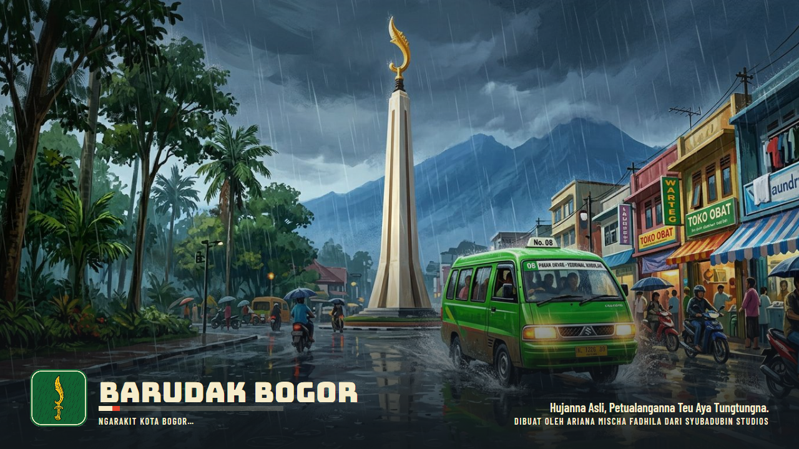
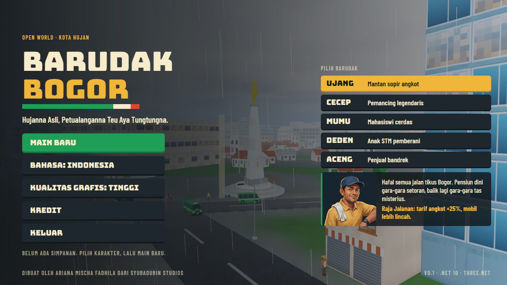

# Memulai

Dibuat oleh Ariana Mischa Fadhila dari Syubadubin Studios. · [English](../en/getting-started.md)



## Kebutuhan

- Windows 10 atau 11 64-bit (satu-satunya platform yang sudah diuji)
- .NET SDK 10
- GPU dengan DirectX 12. Grafis terintegrasi bisa, tetapi lambat: sekitar 20–28 fps di Intel UHD 620.

Rust **tidak** diperlukan untuk mem-build game: inti native Three.Net sudah tersedia di paket NuGet `ThreeNet.Native`.

## Build, jalankan, tes

```bash
dotnet build BarudakBogor.slnx -c Release
dotnet run --project src/BarudakBogor.Game -c Release
dotnet test tests/BarudakBogor.Core.Tests
dotnet test tests/BarudakBogor.Core.Tests --filter "FullyQualifiedName~PrologueCanBePlayedThrough"
```

## Opsi baris perintah

| Opsi | Fungsi |
|---|---|
| `--capture <folder>` | Menjalankan tur terskrip, menyimpan tangkapan layar di tiap pemberhentian, lalu keluar. Gambar di dokumentasi berasal dari sini. |
| `--bench <file>` | Menyetir rute yang sama di tiap tingkat kualitas dan menulis FPS ke file teks. |

## Menit-menit pertama

1. Pilih karakter di menu utama, lalu **Main baru**.
2. Jalan ke penanda emas di samping Tugu Kujang dan tekan **E** untuk memulai "Tas Misterius".
3. Tekan **M** untuk peta. Klik tempat mana pun dan naik ojek ke sana dengan ongkos.
4. Tekan **Esc** untuk misi, karier, pengaturan dan daftar kontrol.



## Pengaturan

- **Bahasa**: Indonesia atau Inggris, bisa diganti kapan saja.
- **Kualitas grafis**: Hemat, Sedang, Tinggi. Hemat merender di resolusi lebih rendah tanpa bayangan.
- **Suara** dan **volume**.

Simpanan dan pengaturan ada di `%AppData%\BarudakBogor`. Game menyimpan saat misi selesai, saat keluar, dan saat menekan **F5**.

## Membuat ulang aset

```bash
blender --background --python assets/blender/build_all.py        # 46 model low-poly
blender --background --python assets/blender/optimize_rodin.py   # versi siap-pakai model Rodin
```

## Pemecahan masalah

| Gejala | Yang dilakukan |
|---|---|
| FPS rendah | Setel kualitas grafis ke Hemat; perkecil jendela. |
| Tidak ada suara | Tab pengaturan menampilkan alasannya bila perangkat audio tidak ditemukan. Game tetap jalan tanpa suara. |
| `DllNotFoundException: threenet_core` | Pulihkan paket NuGet (`dotnet restore`). |
