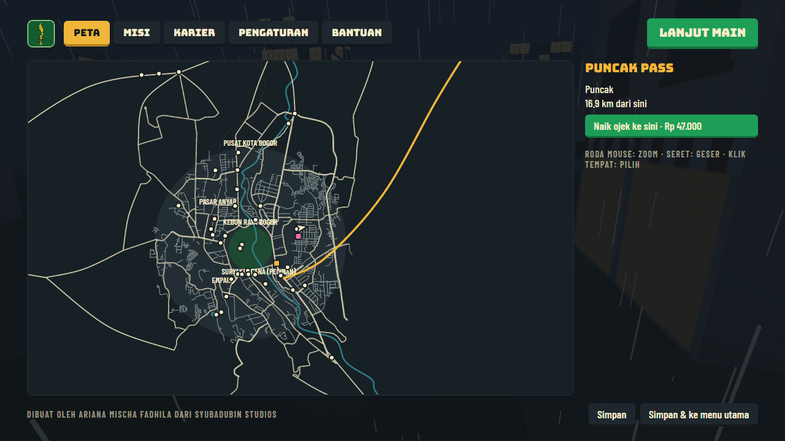
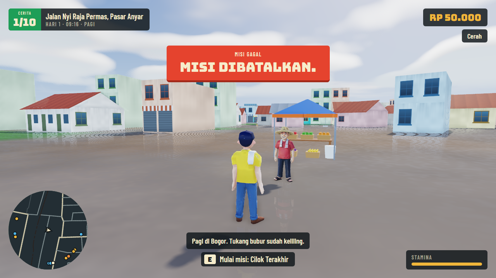
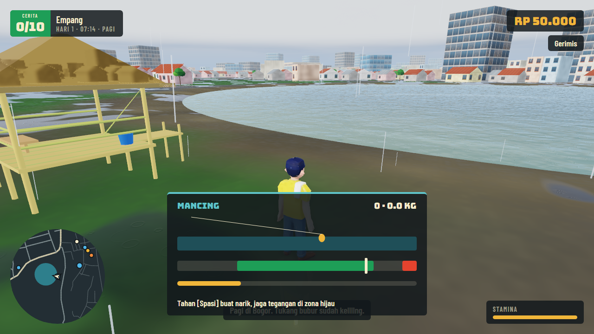
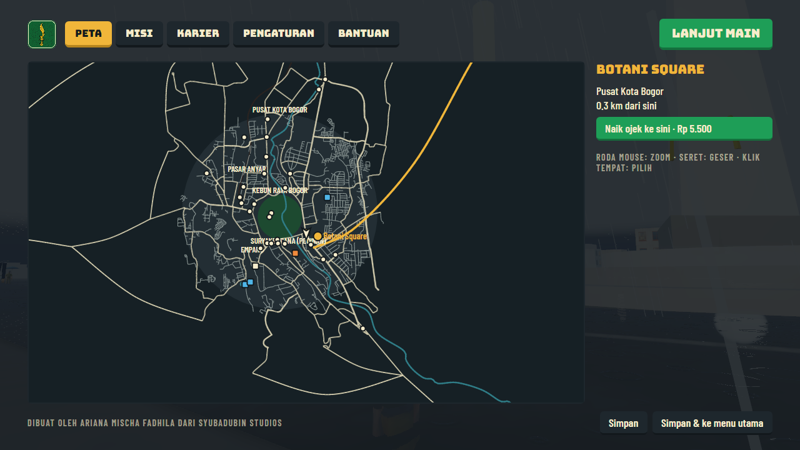
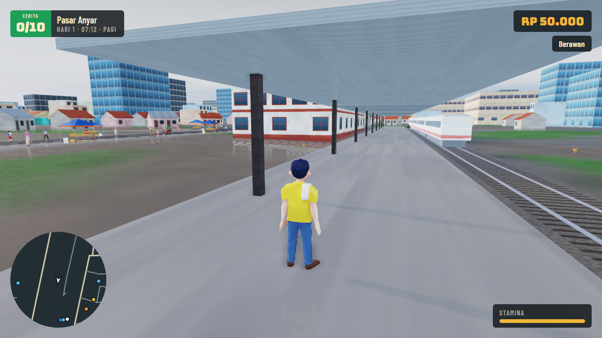

# Panduan bermain

Dibuat oleh Ariana Mischa Fadhila dari Syubadubin Studios. · [English](../en/gameplay.md)

## Karakter

Tiap karakter mengubah cara main di satu bagian game.

| Karakter | Siapa | Kemampuan |
|---|---|---|
| Ujang | Mantan sopir angkot | Tarif angkot +25%, ban lebih mencengkeram saat basah |
| Cecep | Pemancing legendaris | Ikan lebih cepat menyambar, tarikan lebih kuat |
| Mumu | Mahasiswi cerdas | Hadiah misi +15%; bisa meredakan tawuran STM dengan omongan |
| Deden | Anak STM | Lari lebih kencang, stamina lebih awet; bisa meredakan tawuran STM dengan omongan |
| Aceng | Penjual bandrek | Untung jualan +30% |

## Dunia

Peta berukuran 40 km x 40 km dengan Tugu Kujang di tengah. Timur di kanan, selatan di bawah.

| Area | Isinya |
|---|---|
| Pusat Kota | Tugu Kujang, jalur lingkar Kebun Raya, kantor dan ruko |
| Kebun Raya | Pohon besar, tupai, padang rusa Istana |
| Pasar Anyar | Tenda pasar, kios, keramaian: tempat terbaik jualan bandrek |
| Gang Selot | Labirin gang yang hanya muat motor dan gerobak |
| Empang | Rumah kampung, empang pemancingan, lapangan badminton, kontrakan |
| Dramaga | Kampus IPB, pangkalan angkot, Situ Gede |
| Sentul | Jalan lebar, sirkuit, lewat Tol Jagorawi |
| Puncak | Tikungan tajam, kebun teh, hutan pinus, kabut, monyet, dan Villa Misterius |

Menyetir dari kota ke Puncak makan waktu sekitar seperempat jam. Dari peta (**M**) kamu bisa naik ojek ke tempat mana pun dengan ongkos; ini tidak bisa saat misi berjalan.

## Cuaca dan waktu

Satu hari game berlangsung 24 menit nyata. Hujan paling sering turun antara pukul 13.00 dan 19.30.

- **Jalan basah** mengurangi cengkeraman ban sampai setengah: rem lebih awal, belok pelan.
- **Badai petir** bisa memadamkan listrik satu lingkungan selama satu-dua menit: jendela dan lampu jalan gelap.
- **Kabut Puncak** paling tebal saat subuh, senja, dan hujan.
- Hujan ada untungnya: ikan lebih cepat nyamber, order ojol dibayar 50% lebih, bandrek lebih laris, dan foto bernilai lebih tinggi.

## Misi cerita

Mulai misi di penanda emasnya, tempat pemberi misi menunggu. "Tas Misterius" membuka misi lainnya.

| # | Misi | Tempat | Yang dilakukan |
|---|---|---|---|
| 1 | Tas Misterius | Tugu Kujang | Temukan tas di angkotmu, lalu kabur dari dua mobil hitam ke Empang |
| 2 | Cilok Terakhir | Pasar Anyar | Ikuti tiga petunjuk, temukan gerobak di Gang Selot, dorong pulang |
| 3 | Narik Sampai Kaya | Pangkalan Dramaga | Narik angkot sampai Jalan Baru, berhenti di tiap halte |
| 4 | Anak Bina Insani | Empang | Jemput anak-anak dan sampai sekolah sebelum 07.00 |
| 5 | STM vs STM | Lapangan dekat STM | Cegah tawuran: ceramah, traktir bandrek, atau mobil tahu bulat |
| 6 | Master Empang | Empang | Dapatkan 4 kg ikan dalam tiga menit |
| 7 | Bandrek King | Warung Aceng | Dorong gerobak ke tempat ramai dan jual delapan gelas |
| 8 | Horor Puncak | Puncak Pass | Selidiki villa di malam hari, jalan kaki |

Misi yang gagal atau dibatalkan bisa dimulai lagi. Game tidak bisa disimpan saat misi berjalan.

## Aktivitas

| Aktivitas | Tempat | Cara |
|---|---|---|
| Mancing | Empang, Situ Gede | Spasi untuk melempar, Spasi saat pelampung tenggelam, lalu tahan Spasi untuk menarik sambil menjaga jarum di zona hijau |
| Ojol | Di mana saja, di atas motor | **O** untuk mulai narik; jemput, lalu antar sebelum waktu habis |
| Touring Puncak | Simpang Ciawi | Naik kendaraan bermesin, lewati semua checkpoint sampai Puncak Pass; hadiah tergantung waktu |
| Badminton kampung | Empang | A/D saat kok sampai garis; tiga kali lepas berarti kalah |
| Karaoke | Pusat Kota | A/S/D/F saat not sampai garis |
| Fotografi | Di mana saja | **P**. Hujan, kilat, kabut, golden hour, landmark dan satwa di dalam bingkai menambah poin; 40 poin ke atas dibayar. Foto tersimpan di `Pictures\BarudakBogor` |
| Usaha bandrek | Warung Aceng | Belanja stok, dorong gerobak, berhenti di tempat ramai. Naik kelas jadi warung, kedai, franchise; ambil setoran di warung |

## Karier

Capai 100 reputasi di satu karier untuk meraih gelarnya. Game tetap berlanjut setelahnya.

| Gelar | Cara mendapat reputasi |
|---|---|
| Raja Angkot | Misi narik angkot |
| Pengusaha Bandrek | Menjual bandrek dan menaikkan kelas usaha |
| Influencer Kuliner | Foto yang dibayar, antar makanan, karaoke |
| Pemancing Legendaris | Menangkap ikan, menang turnamen |
| Walikota | Misi cerita, order penumpang, touring, badminton. Menamatkan sepuluh misi cerita langsung memberi gelar ini |

Menabrakkan kendaraan ke arah pejalan kaki mengurangi reputasi Walikota. Mereka selalu sempat loncat.

## Kota

Pusat peta disusun seperti Bogor yang asli, diukur dari Tugu Kujang: lingkar Kebun Raya (Pajajaran, Otista, Juanda, Jalak Harupat), jalan-jalan utama, Ciliwung, dan rel KRL mengikuti garis sebenarnya (data peta © kontributor OpenStreetMap). Jalan kecil dibangkitkan.

Tempat yang bisa didatangi dan dituju dengan ojek antara lain Istana Bogor, museum (Zoologi, PETA, Tanah dan Pertanian), mal (Botani Square, Bogor Trade Mall, Yogya Bogor Junction, Ramayana, Plaza Jambu Dua, Ekalokasari, Lotte Mart, Bogor Great Mall), Lawang Suryakencana, Air Mancur, Lapangan Sempur, GOR Pajajaran, Stasiun Bogor, dan Terminal Baranangsiang. Bangunannya masih generik; papan nama belum ada.

KRL berangkat dari Stasiun Bogor tiap beberapa menit lalu kembali. Kereta berhenti kalau ada orang di rel, dan lalu lintas menunggu di perlintasan.

## Misi tambahan

| | Misi | Mulai di | Yang dilakukan |
|---|---|---|---|
| 9 | Isi Flashdisk | Kampus IPB Dramaga | Buka flashdisk (setelah Cilok Terakhir), temukan patok ukur di gerbang Kebun Raya, bawa buktinya pulang |
| 10 | Rapat Warga | Tugu Kujang | Ajak Mang Udin, Haji Dadang, dan Abah Aceng, lalu hadapi Pak Beton. Ada tiga cara menyelesaikannya |
| Sampingan | Paket Nyasar | Gang Selot | Tiga antaran naik motor, berpacu dengan waktu |
| Sampingan | Rusa Kabur | Padang Rusa Istana | Giring rusa pulang dengan jalan kaki, tanpa lari |
| Sampingan | Delman Istimewa | Gerbang Kebun Raya | Keliling pelan-pelan; terlalu cepat, es krimnya jatuh |

## Gamepad dan kamera

Gamepad bisa dipakai saat bermain dan di menu (d-pad memindahkan sorotan, A menekan, B kembali, LB/RB ganti tab). **V** atau d-pad kanan berpindah antara kamera belakang dan orang pertama. Di kendaraan tertutup lensa orang pertama ada di moncong, karena modelnya belum punya interior.
